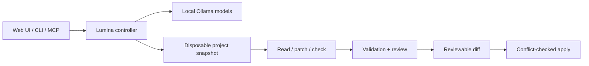

<div align="center">

# ✦ Lumina

**A local-first AI workspace for learning, everyday questions, and safer coding workflows.**

Built as a personal project to explore how far an AI assistant can go without depending on cloud-hosted model inference.


[Overview](#overview) · [Features](#features) · [Architecture](#how-it-works) · [Development](#development) · [Documentation](#documentation)

</div>

---

## Overview

**Lumina** combines a self-hosted chat/study interface with a coding agent that works on isolated project snapshots. The goal is to make local AI useful for real tasks while keeping file changes deliberate, reviewable, and reversible.

Model inference runs through a local Ollama setup. An optional web-search feature can send queries to search providers when enabled, so **local inference does not mean every feature is completely offline**.

> **Project status:** Lumina is a Linux-focused personal project and technical experiment, not a hosted service or a one-click consumer application. Setup currently depends on the machine's models, services, and sandbox configuration.

## Features

| Area | What Lumina provides |
| --- | --- |
| **Local AI chat** | An interface for conversations, study questions, model selection, and formatted answers |
| **Coding agent** | Task plans, source inspection, targeted file edits, command checks, and a review step |
| **Safer edits** | Disposable source snapshots, hash-checked patches, validation of the exact revision, and conflict checks before applying |
| **Developer tools** | Web dashboard, command-line interface, and Model Context Protocol (MCP) integrations |
| **Documents & images** | Local attachment parsing and image-assisted workflows, with file-type and size limits |
| **Optional search** | Web-assisted answers via an independently configured search service |
| **Linux integration** | Designed around a local Linux development environment, including a Wayland/OpenClaw integration |

The coding workflow is deliberately bounded: the model cannot silently apply arbitrary changes to the original project. Tests and model reviews provide evidence, **not a guarantee of correctness**.

## How it works



The controller owns task limits, source validation, and the final apply gate. Model-generated actions run with constrained interfaces; command checks use an isolated, network-restricted environment.

For implementation details, see the [architecture document](docs/architecture.md) and [verification notes](docs/verification.md). Verification notes describe specific tests and hardware configurations, not a universal performance guarantee.

## Technology

- **Backend:** Python 3.11+, Python standard-library HTTP server, Ollama integration
- **Interface:** HTML, CSS, JavaScript
- **AI workflows:** Local language models, bounded tool use, MCP
- **System integration:** Linux, systemd, Bubblewrap sandboxing, optional Wayland integration
- **Quality:** Python `unittest` suite and project-specific behavioral checks

## Development

This is a **developer setup**, not a complete automated deployment procedure. A usable installation also needs an appropriate Ollama service and installed model, local sandbox dependencies, and configuration suited to the host.

```bash
git clone https://github.com/Alden-Gerald/Lumina.git
cd Lumina

python3 -m venv .venv
source .venv/bin/activate
python -m pip install -e .

# Explore supported commands
local-coder --help

# Run the Python test suite
python -m unittest discover -s tests -v
```

After configuring the required local services, the dashboard server can be started with `local-coder serve`. The default dashboard binds to loopback; do not expose it directly to the public internet.

**Naming note:** The repository is branded **Lumina**, while its existing Python package and CLI remain **`local_coder` / `local-coder`** for compatibility. This documentation update does not rename executable interfaces.

See [development notes](docs/DEVELOPMENT.md) before changing application code or configuring LAN access.

## Repository structure

```text
Lumina/
├── local_coder/        # Controller, APIs, model integration, and web UI
├── integrations/       # Optional desktop and MCP-related integrations
├── services/           # Service definitions for the host environment
├── config/             # Configuration examples and service settings
├── scripts/            # Setup, diagnostics, and maintenance helpers
├── tests/              # Automated checks and regression tests
├── docs/               # Architecture, verification, plans, developer notes
├── pyproject.toml      # Python package metadata
└── README.md
```

## Documentation

| Guide | Purpose |
| --- | --- |
| [Documentation index](docs/README.md) | Find the right technical reference |
| [Development notes](docs/DEVELOPMENT.md) | Environment expectations, tests, and safe contribution workflow |
| [Architecture](docs/architecture.md) | Agent execution flow and sandbox boundaries |
| [Verification](docs/verification.md) | Recorded test results and implementation caveats |
| [Parallel agent roadmap](docs/parallel-agents-roadmap.md) | Agent-design notes and planned improvements |
| [Product roadmap](roadmap.md) | Design checklist; items may be planned rather than complete |

## Safety and privacy

Lumina is designed around local model execution and explicit review before applying code changes. Additional network features, including search and optional LAN access, require separate configuration. Do not commit private keys, credentials, model data, user documents, or local service tokens.

If you discover a security issue, read [SECURITY.md](SECURITY.md) before reporting it. Treat this experimental code as **not security-audited for production exposure**.

---

<sub>Made by [Alden Gerald Kusnadi](https://github.com/Alden-Gerald) · Personal software engineering project</sub>
