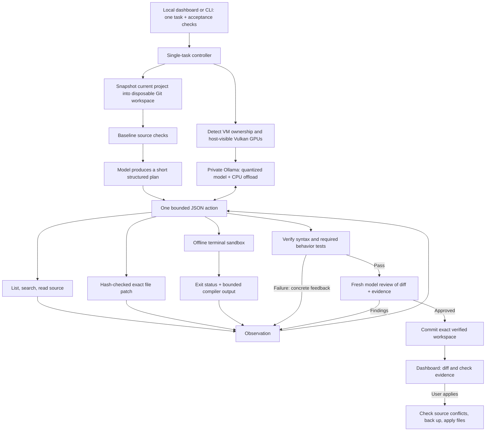

# Installed architecture

Model inference is sequential. The reviewer is a fresh request to the same local
model, rather than another simultaneous GPU process. It is a second pass, not an
independent model guarantee. Required tests supplied by the operator are separate
from both model passes.

The trusted controller owns model options, task budgets, validation and commit.
The model cannot change context size, load models, increase resource budgets,
apply to the live checkout, access the host GPU through a shell command, or call
Git commit. Repository text and terminal output are presented as untrusted data.
There is no `eval` of model output.

The model emits `summary`, `tool`, and `arguments` matching a constrained JSON
schema. `summary` is a short visible action description, not a reasoning transcript.
Planning/review use smaller separate schemas. Reads return the complete current
file hash even when the requested source range is truncated. File patches require
that hash and a unique exact match, preventing stale and ambiguous replacements.

Command code executes in a separate user/PID/network/IPC/mount namespace with
its own constrained process-tree scope. The read-only source mount prevents
commands from bypassing surgical edits or weakening tests. Scratch build files
can be written inside bounded `/tmp`; logs are captured outside the task source.

The controller stores each plan, action, observation, check and model metric.
The next request includes the task, plan, recent failure ledger and recent complete
turn pairs. Old pairs are discarded when CPU tokenizer accounting approaches
the configured window, reserving 2,500 tokens for template/generation overhead.
Oversized actions and repeated output are rejected before execution.

Before committing and before applying, the exact source inventory must match the
inventory that passed validation. Apply also requires the original source files
to match the task's starting manifest. Unrelated user edits remain untouched.

Hardware selection happens at task boundaries. The inference process uses only
the selected Vulkan devices. NVIDIA bound to VFIO is excluded even if a stale
enumeration claims it exists. Explicit VM reservation excludes it too. A mode
change restarts only the private inference service; it does not mutate PCI drivers.
Mixed-vendor distribution and handback remain subject to real driver qualification.
